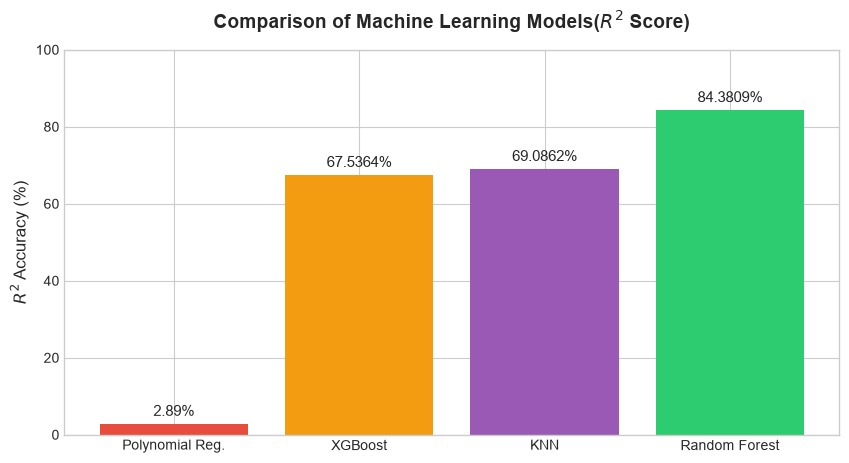
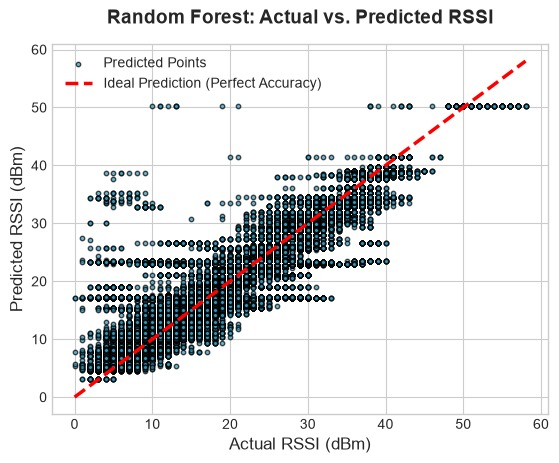

# 📶 Telecommunication Path Loss Prediction using Machine Learning

## 📌 Project Overview
This project aims to predict indoor Wi-Fi signal attenuation (Path Loss / RSSI) based on distance using Machine Learning. Traditional mathematical models fail to capture the complex, non-linear behavior of wireless signals due to environmental noise and obstacles. This project implements and compares multiple ML algorithms to find the most accurate prediction model, laying the foundation for advanced RF planning.

## 💡 Real-World Applications
The core ML pipeline developed in this project scales to solve major telecommunication challenges:
* **Indoor RF Planning:** Optimizing Access Point (AP) installation distances in public spaces to eliminate dead zones.
* **Macrocell & 5G Tower Placement:** Predicting signal coverage over terrains to reduce the need for physical drive testing.
* **Smart City Infrastructure:** Ensuring reliable connectivity for IoT devices and microcontroller-based sensor networks.
* **Telecommunication Digital Twins:** Generating predictive RF heatmaps in 3D simulated environments prior to hardware deployment.

## 🛠️ Tech Stack
* **Language:** Python
* **Libraries:** Scikit-Learn, Pandas, NumPy, Matplotlib
* **Environment:** Jupyter Notebook

## 📂 Dataset
The dataset used for this project contains real-world indoor Wi-Fi RSSI measurements and distance logs. It was sourced from **[kaggle.com]** and can be publicly accessed here: **[https://www.kaggle.com/datasets/amirma/indoor-location-determination-with-rssi]**. 
*Note: For the primary analysis, data from a single access point was filtered out to prevent hardware-induced variance (Tx Power, Antenna Gain differences) from impacting the model's accuracy.*

## 📊 Models Evaluated
To isolate hardware variables, data from a single access point was used. The following models were compared:
1. Polynomial Regression
2. XGBoost Regressor
3. K-Nearest Neighbors (KNN) Regressor
4. **Random Forest Regressor (Best Model)**

## 🏆 Key Results
The **Random Forest Regressor** achieved the highest accuracy with an **$R^2$ score of 84.38%**, successfully identifying the underlying signal degradation pattern despite heavy environmental noise.

### Model Comparison

### Actual vs. Predicted (Random Forest)

## 🚀 Future Scope
Moving forward, I plan to incorporate additional features such as Wall Count, Line of Sight (LoS), and specific Router IDs to build a generalized multi-AP prediction system. 

*Special thanks to the open-source community for providing the machine learning and data visualization libraries used in this research.*
